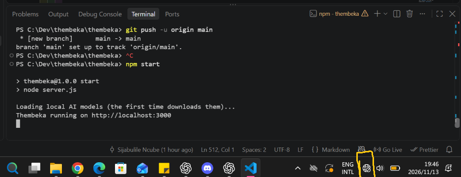
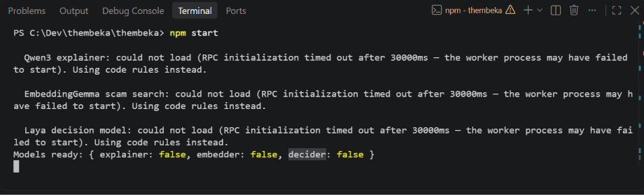
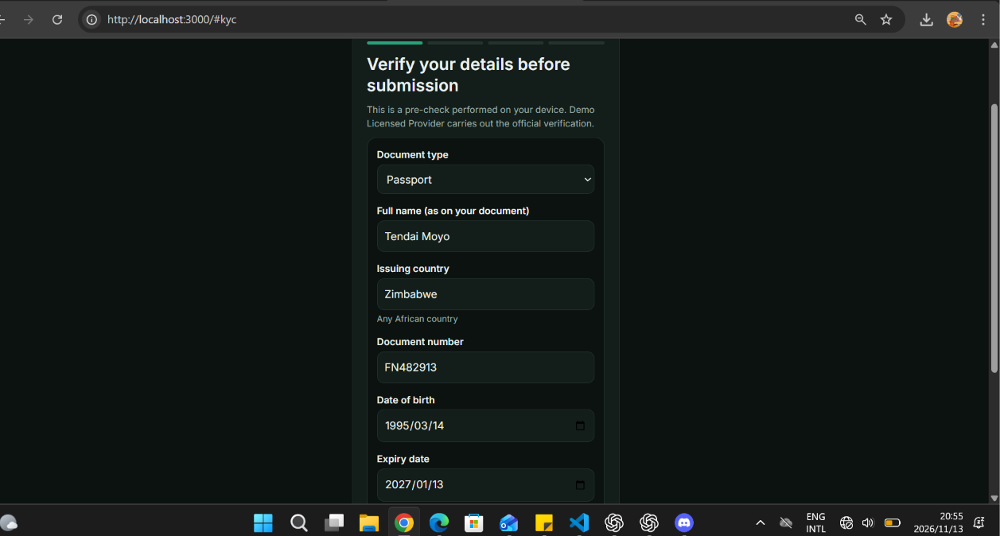
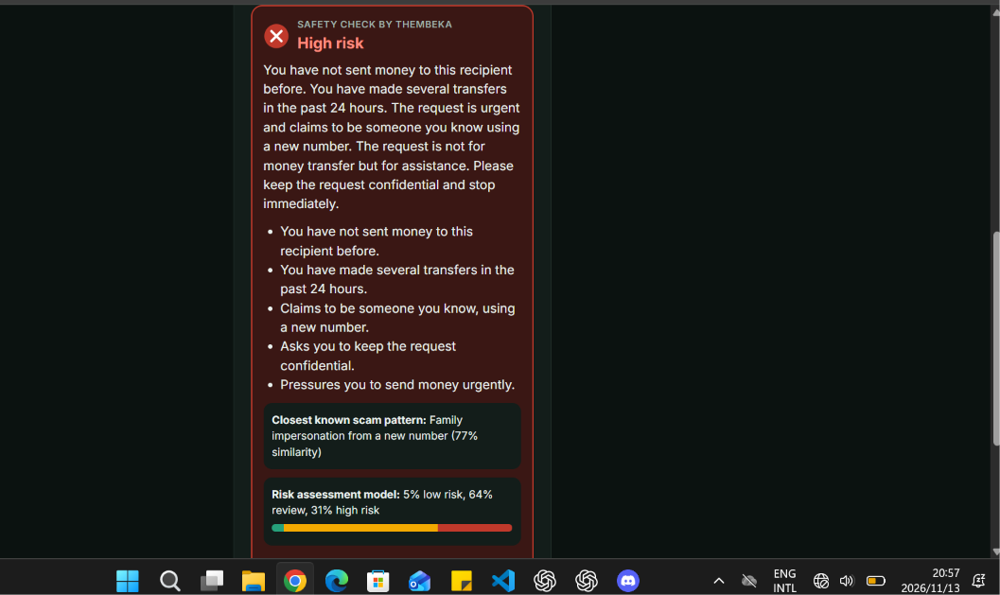
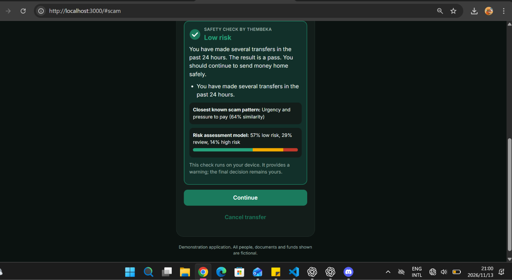

# Thembeka

**Send money home safely.** Thembeka (isiZulu: "be trustworthy") is a trusted, legal and private way for Africans to send money home in USDT. A local AI on the device checks your ID details and screens every request for scams, **offline**, and nothing is sent until you approve it.

Built for the **GAIC x Tether Advanced AI Foundations Bootcamp** (November 2026) with Tether's **QVAC SDK** for local AI and the **Wallet Development Kit (WDK)** for USDT.

## Demo video

- ▶️ [Part 1: Thembeka demo](https://www.loom.com/share/e120dbf0fae94b88ae57d8838888916d)
- ▶️ [Part 2: Thembeka demo](https://www.loom.com/share/a472a37474ac4a8aa6a54f0c2a3ea2df)

---

## The problem

Across Africa, millions of migrants and cross-border traders send money home through informal carriers and street money changers. Every country has its own name for them: *omalayisha* in Zimbabwe, *onyamula katundu* in Malawi, *cambistas* in Mozambique and Angola, *hawala* networks in Swahili-speaking East Africa, including Kenya and Tanzania. The fee changes every month, the money passes through many hands, and sometimes it never arrives, with no receipt and no recourse. Scam messages pretending to be family make it worse.

Thembeka starts in South Africa, home to migrants from across the continent, and is built to work for any African corridor.

## What Thembeka does

| Step | What happens | Where |
|---|---|---|
| 1. ID pre-check | Checks your passport or ID details are complete and valid before you submit them | On your device, offline |
| 2. True cost | Shows what the recipient actually gets with each option, with a fixed fee upfront | On your device |
| 3. Safety check | Checks the message that asked for money for scam and money mule warning signs | On your device, offline |
| 4. You approve | Nothing is sent until you tap **Approve and send** | You decide |
| 5. Recipient confirms | The recipient selects **Confirm receipt**, so the sender knows the funds arrived | Both devices |

**Who does what:** Thembeka does the **pre-checks** on the device. The **licensed provider** does the **official** ID verification and ongoing monitoring. **You** always make the final decision.

## How the safety check works

The code rules decide what must be exact. The local AI reads language and explains results. The AI can only make a result **stricter**, never safer.

| Layer | Done by |
|---|---|
| Transfer rules: new recipient, unusual amount, many sends | Code |
| Warning words: new number, secrecy, urgency, pay-to-receive, money mule | Code |
| Closest known scam, matched by meaning (not exact words) | EmbeddingGemma + a scam library (QVAC `embed`) |
| Low risk, review or high risk, as probabilities | Laya decision model (QVAC `decide`) |
| Plain-language explanation | Qwen3 0.6B (QVAC `completion`) |

If any model is missing or slow, that step falls back to the code rules, so the app always works.

---

## Requirements

- **Node.js 22.21.x** (22.17 or newer) and **npm 10.9** or newer
- **8 GB RAM** minimum (16 GB recommended)
- About **1.2 GB** free disk space for the three models
- Internet for the **first run only** (to install packages and download the models)

Check your versions:

```
node --version
npm --version
```

## Install and run

```
git clone https://github.com/Sijabulile-Ncube/thembeka.git
cd thembeka
npm install
copy .env.example .env
npm start
```

On macOS or Linux, use `cp .env.example .env` instead of `copy`.

Open **http://localhost:3000** in your browser. The first start downloads the models; the badge at the top changes to **Offline checks ready** when they're loaded.

> `npm install` may report "vulnerabilities". Don't run `npm audit fix --force`: it can change the pinned QVAC SDK version.

### Other commands

| Command | What it does |
|---|---|
| `npm start` | Starts the app with the local AI models |
| `npm run start:no-ai` | Starts quickly without AI (code rules only), for testing screens |
| `npm test` | Runs the rule tests (KYC, safety check, cost maths) |
| `npm run check-models` | Loads all models and runs each on the demo messages, with timings |

## Test it offline

1. Run `npm start` once with Wi-Fi on, and wait for **Offline checks ready**.
2. Turn Wi-Fi **off**.
3. Run the ID pre-check, the true-cost comparison and the safety check. They all work with no internet.
4. Turn Wi-Fi back on for the final send (in testnet mode).

## Offline proof

These screenshots were taken on a Windows 11 laptop with **Wi-Fi switched off**. All three AI models ran locally through the QVAC SDK.

| | |
|---|---|
| Wi-Fi off, local models ready |  |
| Terminal: all three models loaded |  |
| ID pre-check: Review required |  |
| Scam message: High risk |  |
| Genuine request: Low risk |  |

## Demo walkthrough

1. Select **Send money home**, then **Check my details**. The demonstration passport expires within two months, so the result is **Review required**.
2. Select **Submit to Demo Licensed Provider**, then **Continue**.
3. Select **Compare total cost** for R1,500. Grandma Moyo receives the highest amount through Thembeka.
4. Select **Scam: family member on a new number**, then **Check this message**. The result is **High risk**.
5. Select **Cancel transfer**, start again, and select **Genuine request: school fees**. The result is **Low risk**.
6. Select **Approve and send**.
7. Open the recipient view in a second tab and select **Confirm receipt**. The first tab shows **Grandma Moyo has confirmed receipt**.

## Wallet modes

Set `WALLET_MODE` in `.env`:

| Mode | What it does |
|---|---|
| `simulated` (default) | No funds are transferred. A demonstration wallet holds 1,000 test dollars, and each transfer receives a `SIM-` reference. |
| `testnet` | Uses the WDK (`@tetherto/wdk-wallet-evm`) with test USDT on a test network. Needs `SEED_PHRASE`, `RPC_URL` and `USDT_TOKEN_ADDRESS` in `.env`. |

Never commit `.env`: it's listed in `.gitignore`.

---

## Project structure

```
server.js              starts the app, loads the models once
src/
  ai/                  QVAC: models, scam search, decision model, explanations
  checks/              code rules: KYC, transfer flags, warning words, combined result
  money/               cost comparison, wallet, send records
  routes/api.js        the API the screens call
  data.js              loads the demo data
data/                  fictional profiles, demo messages, scam library, demo rates
public/                the web app (plain HTML, CSS and JavaScript, mobile first)
scripts/checkModels.js model check with timings
tests/                 rule tests (Node's built-in test runner)
```

## What works and what's next

**Working and tested**
- ID pre-check with clear Low risk / Review required / High risk results (8 tests)
- Safety check: all 3 demo messages give the expected result using the code rules alone (14 tests)
- True-cost comparison maths (4 tests)
- Full send flow in simulated mode, tested in a browser at phone and laptop sizes
- Approve button stays locked until warning confirmations are ticked
- Local AI models load and run through the QVAC SDK 0.22.0

**Known issues and next steps**
- Testnet sends need the WDK balance and transfer calls completed (`src/money/wallet.js`)
- Exchange rates are fixed demo rates
- Passport details are typed, not scanned
- Next: **voice**, so users can speak a request and hear the result read aloud, using QVAC's local speech-to-text and text-to-speech models
- Next: **AI translation into African languages** such as isiZulu, isiNdebele, Shona, Chichewa and Swahili, running offline on the device
- Next: **pay for essentials directly**, so the sender can buy airtime, mobile data and prepaid electricity for family anywhere in Africa, paid in USDT through licensed partners and checked by the same safety rules
- Next: **local currencies**, so every amount is shown in the recipient's own currency (for example rand, kwacha, metical, shilling, naira or cedi) with the exchange rate stated clearly before the sender approves
- Next: **live exchange rates** from licensed providers, replacing the fixed demo rates
- Next: **mobile money cash-out**, so the recipient can receive funds to a mobile money wallet or collect cash from a licensed agent near home

## Privacy

ID details and messages are processed on the device. Only what the licensed provider needs is shared, and only after the user approves. All people, documents and wallets in this repo are fictional.

## Tech stack

Node.js, Express, plain HTML/CSS/JavaScript, QVAC SDK 0.22.0 (Qwen3 0.6B, EmbeddingGemma 300M, Laya 322M), Tether WDK.

## Author

**Sijabulile "Jabu" Ncube**: credit risk specialist with over a decade in South African financial services, building in software development and AI.

- GitHub: [@Sijabulile-Ncube](https://github.com/Sijabulile-Ncube)
- LinkedIn: [linkedin.com/in/sijabulilemn](https://linkedin.com/in/sijabulilemn)

## Licence

Copyright (c) 2026 Sijabulile Ncube. All rights reserved.

This code is public for viewing and assessment only. It may not be copied, modified, distributed or used without written permission. See [LICENSE](LICENSE).
